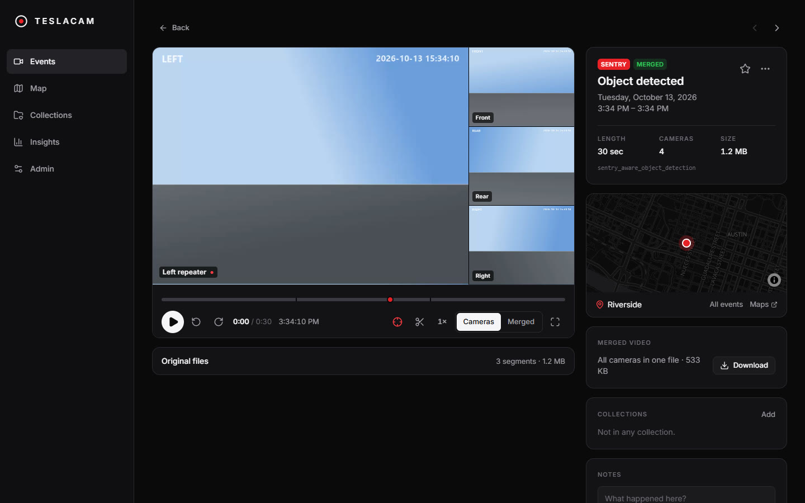
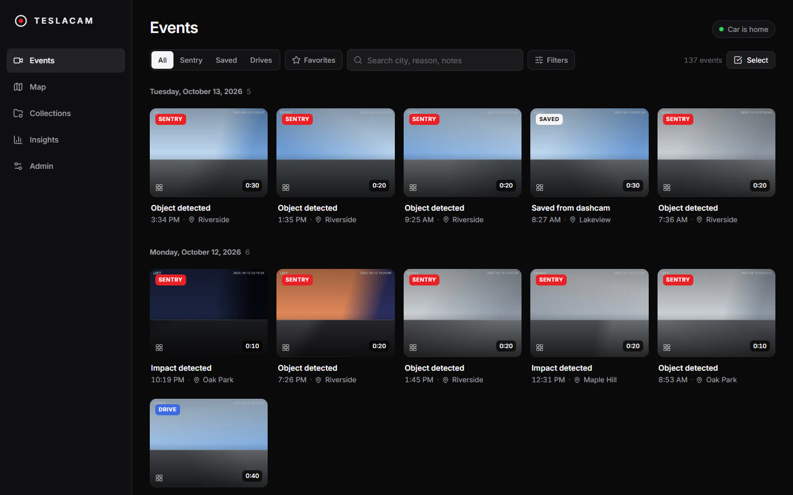
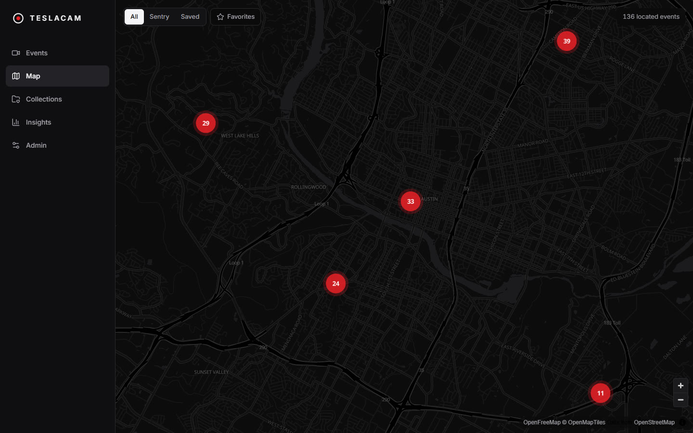
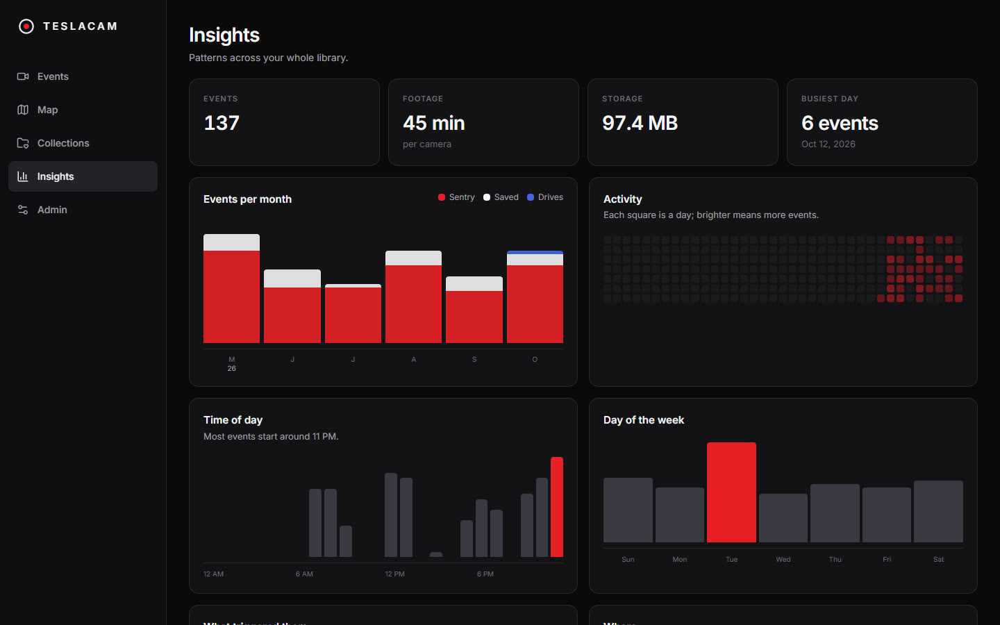
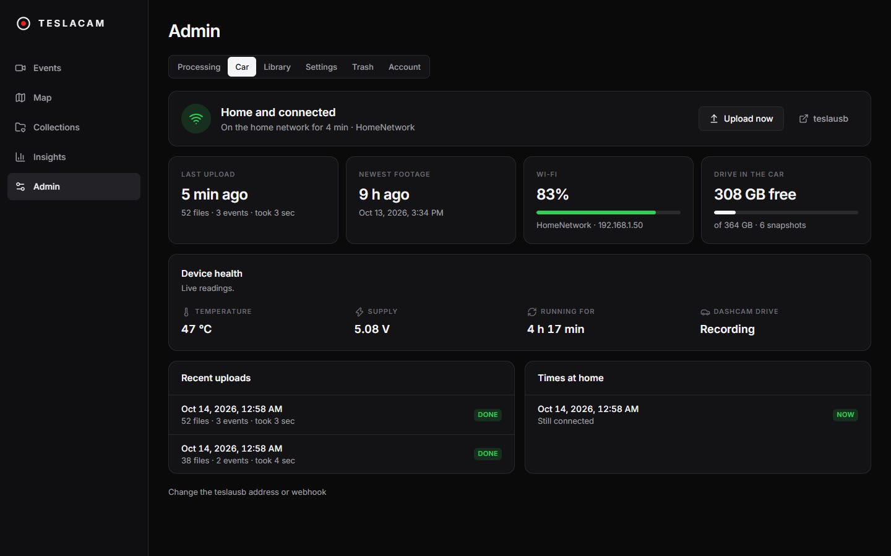

<div align="center">
  

  <h1>TeslaCam Viewer</h1>

  <h3>Your Tesla's Sentry and dashcam clips, with every camera in sync.</h3>

  <p>
    <a href="https://darkmariachi.github.io/teslacamviewer/"></a>
  </p>

  <p>
    <a href="https://github.com/darkmariachi/teslacamviewer/actions/workflows/ci.yml"></a>
    
    
    <a href="LICENSE"></a>
  </p>
</div>

# Overview

TeslaCam Viewer turns the clips your Tesla records into a library you can actually use. Every event becomes one
continuous video with all cameras in sync and the trigger marked, placed on a map, searchable, and cleaned up for
you when you want it to be.

There are two ways to run it, from the same code:

- **The desktop app** for Windows and Linux. Install it, plug the car's USB drive in, press Import. Nothing else to
  set up.
- **The server** for a NAS or home server, with Docker. Open it from any browser, phone included, and pair it with
  [teslausb](https://github.com/marcone/teslausb) so clips upload by themselves when the car gets home.

Your clips stay on your own computer. There is no account, no cloud and no telemetry.

> **v2** is a full rewrite (.NET 10, React, SQLite, ffmpeg). The original .NET 5 / Angular app is still
> available in the [earlier history](../../tree/152f739).

<p align="center">
  
</p>

## Features

- Every Sentry event, saved clip and drive as a card with a thumbnail, reason, place and time
- One timeline per event instead of one-minute files, with every camera playing in sync and the trigger marked
- Import from the car's USB drive, skipping what you already have, and optionally clear the drive afterwards
- Hover a card to play the car's own few seconds around the trigger, on cars new enough to save them
- Merged grid videos that play well on a phone and are easy to share, plus clip export from any range
- Trim long Sentry events down to the minutes around the trigger
- A clustered map of where events happened, and insights by month, hour, weekday, reason and place
- Collections, notes and favorites
- Safe deletion through a trash folder next to your clips, restorable until it expires
- Optional [teslausb](https://github.com/marcone/teslausb) integration: see when the car is home, follow uploads,
  and clean up Sentry events recorded at home
- Hardware encoding on NVIDIA, AMD, Intel and Apple graphics, with a software fallback
- A built-in guide (Help) for everything below

## Screenshots

<table>
  <tr>
    <td width="50%"></td>
    <td width="50%"></td>
  </tr>
  <tr>
    <td align="center"><sub>The library, grouped by day</sub></td>
    <td align="center"><sub>Where events happened</sub></td>
  </tr>
  <tr>
    <td></td>
    <td></td>
  </tr>
  <tr>
    <td align="center"><sub>Insights across the whole library</sub></td>
    <td align="center"><sub>The car's teslausb device, from the home network</sub></td>
  </tr>
</table>

<sub>The footage, places and device in these screenshots are generated. Your library shows your own clips.</sub>

## Status

v2 is new. The server is in use with a 2023 Model Y archived by teslausb on a Raspberry Pi 5; the desktop app has
been run on Windows 11. Here is what has and has not been tried.

| Area                                                        | State                                          |
| ----------------------------------------------------------- | ---------------------------------------------- |
| Library, player, map, insights, collections, notes          | Works                                          |
| Merged videos, clip export, trimming                        | Works                                          |
| Deleting, trash and restoring                               | Works                                          |
| Importing in a browser, and from a drive in the desktop app | Works                                          |
| The car's own event clip on hover                           | Works                                          |
| teslausb status, upload notifications and "Upload now"      | Works                                          |
| Desktop app on Windows                                      | Works                                          |
| NVIDIA and AMD hardware encoding (Windows)                  | Works                                          |
| Cleaning up Sentry events recorded at home                  | Built and tested; new                          |
| Desktop app on Linux                                        | Built by CI; not yet tried on a Linux desktop  |
| Intel hardware encoding (VAAPI on Linux, Quick Sync)        | Built; falls back to software when missing     |
| Six-camera cars (pillar cameras)                            | Built; tried with generated clips only         |
| HEVC clips                                                  | Built; not yet tried with real HEVC footage    |
| macOS                                                       | Not yet: needs Apple code signing              |

If you try one of the rows that is not marked "Works", an issue saying how it went is very welcome.

## Contents

- [Status](#status) · [Desktop app](#desktop-app) · [Server](#server) · [Getting clips in](#getting-clips-in)
- [Using it](#using-it) · [Keyboard shortcuts](#keyboard-shortcuts) · [teslausb](#teslausb) ·
  [Sentry at home](#sentry-at-home) · [Using it from a phone](#using-it-from-a-phone)
- [Settings](#settings) · [Where things are stored](#where-things-are-stored) ·
  [Troubleshooting](#troubleshooting)
- [Relationship to other projects](#relationship-to-other-projects) · [Development](#development)

## Desktop app

Get it from the [download page](https://darkmariachi.github.io/teslacamviewer/) or the
[latest release](https://github.com/darkmariachi/teslacamviewer/releases/latest).

**Windows 10 or 11**

- `TeslaCam-Viewer-<version>-setup.exe` installs for the current user and adds a Start menu entry.
- `TeslaCam-Viewer-<version>-portable.exe` runs without installing.

The builds are not code-signed, so Windows SmartScreen shows a warning the first time. Choose "More info", then
"Run anyway".

**Linux (64-bit)**

- `TeslaCam-Viewer-<version>-x86_64.AppImage`: make it executable (`chmod +x`) and run it.
- `TeslaCam-Viewer-<version>-x64.tar.gz`: unpack anywhere and run `teslacam-viewer` inside.

The first start asks whether to start a new library in `Videos/TeslaCam Viewer` or to use a folder you already
keep clips in (see [The desktop app's library folder](#the-desktop-apps-library-folder)). The app includes
everything it needs, ffmpeg included, and updates itself from GitHub releases (the Windows installer and the
AppImage). Its window has its own title bar: the menu button at its left holds the app menu, and the lights at its
right minimize, maximize and close.

The desktop app only answers on the computer it runs on. To watch from a phone or another computer, use the
server.

## Server

You need a computer that stays on and runs Docker, such as a home server or NAS. It has been used on x86-64
Linux.

```yaml
services:
  teslacamviewer:
    image: ghcr.io/darkmariachi/teslacamviewer:latest
    container_name: teslacamviewer
    restart: unless-stopped
    user: "1000:1000"            # the user that owns the clips
    environment:
      - TZ=America/Chicago
    volumes:
      - /path/to/teslacam:/teslacam   # where clips are kept: SentryClips/, SavedClips/, RecentClips/
      - ./data:/data                  # database, thumbnails, merged videos
    ports:
      - 7544:8080
    devices:                     # optional: Intel or AMD hardware encoding
      - /dev/dri:/dev/dri
    group_add:
      - "993"                    # host's render group id: getent group render
```

[`docker-compose.example.yml`](docker-compose.example.yml) has the same file with comments. Remove the `devices`
and `group_add` blocks if the machine has no graphics chip to pass through. To build the image yourself instead,
clone this repository and replace `image:` with `build: .`.

Then:

1. Open `http://<host>:7544` and choose a password. First-time setup is only accepted from the local network,
   so it is safe to put the app behind a reverse proxy before you have done it.
2. The first scan starts straight away. Thumbnails come first, so the library is browsable within minutes even
   for thousands of events; reading clip details and merging videos carry on in the background.
3. Admin → Processing shows how far along it is. Admin → Settings sets which events get merged videos, the
   quality, and the hours heavy work is allowed to run.

### Reverse proxy

The app trusts `X-Forwarded-For` and `X-Forwarded-Proto` from private addresses, so a proxy on the same host or
LAN works without extra configuration. Video is served with range requests; make sure the proxy does not buffer
whole responses. Importing in the browser uploads clips of 30 to 40 MB each, so allow request bodies that large.

## Getting clips in

Your Tesla records onto the USB drive in the glovebox, in a folder called `TeslaCam`. There are three ways to
bring the clips in:

1. **Import from the USB drive.** Choose **Import** on the Events page. In the desktop app, plugging the drive in
   is enough: the app offers to import whatever on it is new, also when the drive was already plugged in as the app
   opened, and its clips can be cleared afterwards so the car has room again. In a browser, choose the drive or its
   `TeslaCam` folder and the new clips are uploaded to the server. Clips already in the library are skipped either
   way.
2. **Automatically, with teslausb.** See [teslausb](#teslausb).
3. **Copy the folders yourself** into the clip folder (the server's `/teslacam`, or the desktop app's library
   folder). It is checked every five minutes; Admin → Library → "Scan now" checks straight away. Dragging the
   drive's whole `TeslaCam` folder in works too; an event that is in both places is listed once.

### The desktop app's library folder

On first start the desktop app asks where clips should live: a new library in `Videos/TeslaCam Viewer`, or **a
folder you already keep clips in**, which it reads where they are without copying anything. Admin → Library
switches folders later. Each folder keeps its own notes, favorites and collections, so switching back loses
nothing.

How it handles the awkward cases:

- **Clips copied or moved in while the app was closed** are picked up when it opens. If the drive is still plugged
  in, only what didn't make it across is offered for import, and clearing the drive afterwards removes only what is
  safely in the library. An interrupted copy is finished by importing again, since a file of the wrong size is
  copied again.
- **The library folder is missing** (an unplugged drive, a renamed folder): the app says so, keeps everything it
  knows, never creates an empty folder in its place, and recovers by itself when the folder comes back.
- **A folder on a removable drive, or the car's own drive,** gets a warning before it is used, since the library
  would disappear whenever the drive does.
- **The library itself is never offered as an import source,** so "clear the drive" can't empty it.
- **Clips the car encrypted** are counted and explained, and left on the drive.
- **The drive is unplugged during an import:** what was copied is kept, the import stops with a message, and the
  drive is not cleared.

The clip folder looks like what the car writes:

```
TeslaCam
├── SentryClips/2026-10-13_15-36-30/2026-10-13_15-35-32-front.mp4 …  event.json  event.mp4
├── SavedClips/…
└── RecentClips/…            (optional; grouped into drives)
```

A copy of the whole drive, with the top-level `TeslaCam/` folder, works too. `event.json` is optional; without it
an event simply has no reason, place or map location. Folders still being written are left alone for 90 seconds.

**Turn off the car's dashcam encryption.** Newer Tesla software can encrypt recordings (Controls → Safety →
Encrypt Dashcam Recordings). Encrypted clips go into an `EncryptedClips` folder that only the car or Tesla's
website can open, so they can't be shown here.

## Using it

- **Library.** Filter by type, reason, place and date, search names, places and notes, and sort by date,
  length or size. "Select" applies favorites, collections, merging, trimming or deletion to many events at once.
- **Player.** Click any camera to make it the main view, or switch to the merged grid. Playback starts just
  before the trigger, which is marked on the timeline.
- **Exporting.** The scissors pick a range on the timeline; export it from one camera or as a grid.
- **Trimming.** Newer cars save ten minutes of lead-up with every Sentry event. An event's menu, or Trim in
  selection mode, keeps only the minutes around the trigger (two before and one after by default) and moves
  the rest to the trash folder.
- **Deleting.** Clips move to a `.trash` folder inside your clip folder and can be restored from Admin → Trash
  until the retention period ends (14 days by default). Admin → Trash can clear out old events in bulk while
  always keeping favorites and anything in a collection.
- **Webhook.** Admin → Settings can send a JSON POST to an address of your choice, such as a Home Assistant
  webhook, whenever a new Sentry event arrives.
- **Help.** The app's own guide covers all of this, with the details that differ between the desktop app and
  the server.

## Keyboard shortcuts

| Key               | Action                         |
| ----------------- | ------------------------------ |
| `Space`           | Play / pause                   |
| `←` `→`           | 5 seconds back / forward       |
| `Shift` + `←` `→` | 1 second back / forward        |
| `1`–`6`           | Choose a camera                |
| `G`               | Merged view                    |
| `T`               | Jump to the trigger            |
| `F`               | Full screen                    |

## teslausb

[teslausb](https://github.com/marcone/teslausb) runs on a Raspberry Pi plugged into the car instead of a USB
drive, and copies new clips to a shared folder whenever the car is on your home Wi-Fi. Point the server's
`/teslacam` at that share. The app follows the device without changing teslausb itself:

1. Turn on **Admin → Settings → teslausb**. A Car tab appears in Admin.
2. In **Admin → Car**, enter the address of the teslausb web page (for example `http://teslausb.local`). The
   app polls its status report every 30 seconds; whenever it answers, the car is on the home network.
3. Copy the two lines shown there into `teslausb_setup_variables.conf` and re-run teslausb's setup:

   ```bash
   export WEBHOOK_ENABLED=true
   export WEBHOOK_URL=http://<server>:7544/api/archiver/hook/<token>
   ```

   teslausb then announces each upload as it starts and finishes, and the app rescans shortly after one ends.

The token in the webhook address is the only credential the car needs; the endpoint accepts nothing else
without a login. "Upload now" asks teslausb to start archiving immediately.

## Sentry at home

Cars cut power to their USB ports shortly after you walk away, which can stop teslausb in the middle of an
upload. Leaving Sentry on at home keeps the port powered, but records everyone who walks past.

1. Open an event recorded at home and choose **This is home** from its menu.
2. In Admin → Settings → Sentry at home, turn on the clean-up and pick how long to keep them (three days by
   default). The settings show how many events that covers before you save.

Sentry events within the radius of home then move to the trash once they are that old, and the webhook stops
announcing them. Favorites, events in a collection, saved clips and bumps (something touched the car) are always
kept. This works without teslausb too.

## Using it from a phone

The server works on phones; open the same address on your home network, and add it to the home screen to open
it like an app. Away from home, the safest way in is a private network such as [Tailscale](https://tailscale.com)
on the server and the phone, so nothing is opened to the internet. If you would rather publish it, put it behind
a reverse proxy with HTTPS. The app has a password and slows down repeated wrong guesses, but footage of your car
and its surroundings deserves care.

The desktop app only answers on its own computer.

## Settings

The server reads these from the compose file:

| Variable                      | Default                | Purpose                                                        |
| ----------------------------- | ---------------------- | -------------------------------------------------------------- |
| `TESLACAM_ROOT`               | `/teslacam`            | Folder with the clips                                          |
| `TESLACAM_DATA`               | `/data`                | Database, login keys and derived files                         |
| `TESLACAM_CACHE`              | `$TESLACAM_DATA/cache` | Put thumbnails and merged videos on another disk               |
| `TESLACAM_PASSWORD`           | –                      | Preset the password on first start instead of the setup screen |
| `TESLACAM_ALLOW_REMOTE_SETUP` | `false`                | Allow first-time setup from outside the local network          |
| `TESLACAM_FFMPEG`             | –                      | Folder with `ffmpeg` and `ffprobe`, instead of the `PATH`      |
| `TZ`                          | UTC                    | Used for working hours and "recent" rules                      |

Everything else is in Admin → Settings, in both versions: merged videos (which events, resolution, quality,
frame rate, encoder), working hours, HEVC copies, scan interval, trash retention, trimming, Sentry at home,
teslausb and the webhook.

## Where things are stored

Your clips are only changed when you ask: deleting, trimming, or clearing the drive after an import. Everything
the app makes lives in its data folder: `/data` for the server, `%APPDATA%\TeslaCam Viewer\data` on Windows and
`~/.config/TeslaCam Viewer/data` on Linux for the desktop app.

| Path                            | Contents                                                |
| ------------------------------- | ------------------------------------------------------- |
| `teslacam.db`                   | The index, notes, collections, settings and job history |
| `keys/`                         | Keys that sign login cookies                            |
| `cache/events/<id>/thumb.jpg`   | Thumbnails                                              |
| `cache/events/<id>/preview.mp4` | Merged grid videos                                      |
| `cache/events/<id>/event.mp4`   | Browser-playable copies of the car's own event clips    |
| `cache/events/<id>/t_<n>.mp4`   | H.264 copies of HEVC clips                              |
| `cache/exports/`                | Exported clips                                          |

Deleted and trimmed clips go to `.trash/` inside the clip folder. The desktop app also keeps `config.json` (its
library folder and window position) and `logs/` next to the data folder. Each library folder it has used gets
its own data folder (`data`, then `data-<id>`), listed in `config.json`. [PRIVACY.md](PRIVACY.md) lists
everything the app stores and connects to.

## Troubleshooting

**New clips don't show up.**
Folders still being written are skipped for 90 seconds, and the folder is checked every five minutes.
Admin → Library → "Scan now" runs a scan immediately and shows an error if the clip folder can't be read. Check
that it contains `SentryClips`, `SavedClips` or `RecentClips`, or a `TeslaCam` folder that does.

**There is an `EncryptedClips` folder and nothing plays.**
The car's dashcam encryption is on; see [Getting clips in](#getting-clips-in).

**Deleting or trimming fails.**
The clip folder is read-only, or (on the server) the container runs as a user that can't write to it. Set
`user:` to the owner of the clips (`id -u` and `id -g` on the host).

**A clip doesn't play.**
Some cars record in HEVC, which not every browser plays. The event page offers "Make compatible copies", or set
Admin → Settings to make them automatically.

**Merging is slow.**
Admin → Processing shows whether a graphics chip is used. On the server, pass `/dev/dri` through and add the
host's `render` group id (`getent group render`). Lowering the merged video resolution or limiting work to set
hours also helps.

**The desktop app says it couldn't start.**
The message names the log file (File → Open the log folder). An issue with that log attached is the quickest
way to a fix.

**The Car tab is missing, or says the car is away.**
The Car tab only shows when teslausb is turned on in Admin → Settings. The app reaches teslausb only while the
car is on the home network; if it is home, check that the address in Admin → Car opens teslausb's web page from
the server.

## Relationship to other projects

TeslaCam Viewer is an independent project. It is not affiliated with, or endorsed by, Tesla or the teslausb
project. It reads the files a Tesla writes and, if you set it up, talks to a teslausb device through the status
page and webhook teslausb already has.

- Video work is done by [ffmpeg](https://ffmpeg.org): an LGPL build ships with the desktop app, and the Docker
  image installs Debian's.
- The map uses [MapLibre](https://maplibre.org) with tiles from [OpenFreeMap](https://openfreemap.org), based
  on OpenStreetMap data.
- Privacy: see [PRIVACY.md](PRIVACY.md). There is no telemetry.
- Licence: MIT, see [LICENSE](LICENSE). Bundled software is listed in
  [THIRD_PARTY_NOTICES.md](THIRD_PARTY_NOTICES.md).

## Development

Requires the .NET 10 SDK, Node 22 or newer, and ffmpeg and ffprobe on the `PATH`.

```bash
# API on http://localhost:5283
cd server
dotnet run

# Web app on http://localhost:5183, proxying /api to the server
cd web
npm install
npm run dev
```

Create `server/appsettings.Development.json` (git-ignored) to point at some sample clips:

```json
{ "TESLACAM_ROOT": "C:/clips/sample", "TESLACAM_DATA": "C:/clips/devdata" }
```

| Command                                    | What it does                                                    |
| ------------------------------------------ | --------------------------------------------------------------- |
| `dotnet test`                              | Server tests, from the repository root                          |
| `npm run dev` (in `web/`)                  | Web app with hot reload                                         |
| `npm run build` (in `web/`)                | Type-check and build the web app into `server/wwwroot`          |
| `npm run lint` (in `web/`)                 | Lint the web app                                                |
| `npm run fetch-ffmpeg` (in `desktop/`)     | Download an LGPL ffmpeg build into `desktop/resources/ffmpeg`   |
| `npm start` (in `desktop/`)                | Run the desktop app (after `npm run prepare-server`)            |
| `npm run dist` / `dist:linux` (in `desktop/`) | Build the Windows or Linux installers into `desktop/dist`    |
| `docker compose up -d --build`             | Build and run the server container                              |

For a local desktop build with an ffmpeg you already have, set `FFMPEG_DIR` to its folder instead of running
`fetch-ffmpeg`. Set `TESLACAM_USER_DATA` to run the desktop app with a separate profile, away from your real
library.

### Checks and releases

Four GitHub Actions workflows live in `.github/workflows`:

- **Checks** runs the server tests, the web app's lint and build, and the desktop app's type check for every push
  to `main` and every pull request. Changes go to `main` through pull requests, which need these checks to pass;
  releases come from version tags, so `main` can move ahead of the latest release.
- **Build desktop app** builds the Windows and Linux installers. It runs by hand from the Actions tab, for pull
  requests that touch `desktop/`, and for tags such as `v2.0.0`, which also create a draft release with the
  files attached.
- **Build and publish the Docker image** publishes `ghcr.io/darkmariachi/teslacamviewer` for pushes to `main` and
  for version tags.
- **Website** publishes `site/` to the [download page](https://darkmariachi.github.io/teslacamviewer/) when it
  changes. The page finds the newest release by itself.

### Layout

- `server/Api`: the HTTP endpoints, one file per area.
- `server/Services`: scanning, importing, the job queue and ffmpeg work, trash and trimming, teslausb, home
  clean-up, and desktop mode.
- `server/Data`: the SQLite model and its migrations.
- `web/src`: the React app; `pages/` per screen, `components/` shared, `api.ts` the typed client.
- `desktop/`: the Electron app. It runs a self-contained build of the server on a private local port and shows
  the web app in its window; the window signs in with a secret cookie, so there is no password.
- `site/`: the download page.
- `tests`: scanner, import, timeline, archiver, desktop sign-in and home clean-up tests against throwaway folders
  and databases.
